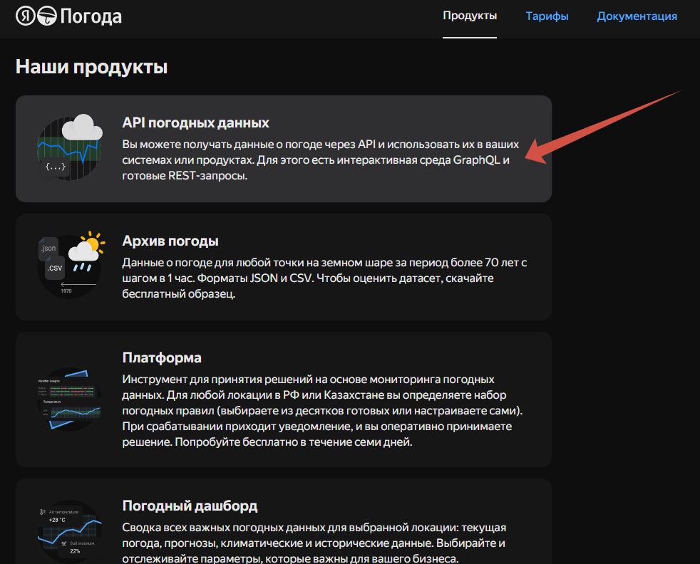
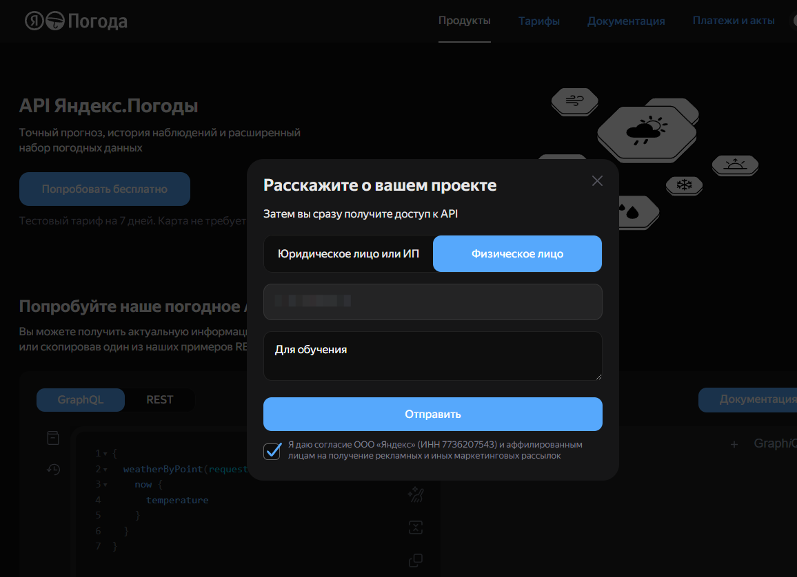
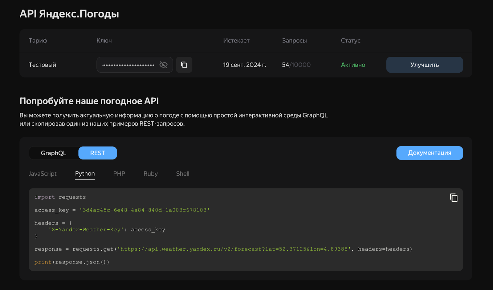

# Реальный опыт: заказ на разработку от реальной организации

Вы поработаете над задачей, которая возникла у реального заказчика. 
Мы не выдумывали ее, чтобы научить вас чему-то, а взяли настоящую задачу и передали вам для решения.

## О заказчике

Источник

PromoIT — аккредитованная IT-компания, 
которая предоставляет услуги по разработке программного обеспечения на заказ от крупных фирм IT-сектора и других отраслей.

## Что нужно делать
Необходимо реализовать сервис для вывода метеорологических данных, получив информацию с удаленного сервиса. В работе необходимо получить данные из сервиса Яндекс: 
https://yandex.ru/dev/weather/doc/ru/concepts/how-to

Нужно получить уникальный ключ, который в дальнейшем необходимо передать в заголовке запроса: 
X-Yandex-Weather-Key

Перед выполнением задания проверьте актуальные условия доступа и тарифы API Яндекс Погоды. 
Бесплатный или возможный тестовый доступ может быть ограничен по сроку, количеству запросов и другим условиям.
Для получения ключа зайдите по ссылке и выберете подходящий сервис:

https://yandex.ru/pogoda/b2b/console/home

После скопируйте ключ и вставьте в своем приложении в заголовке: X-Yandex-Weather-Key.

1. Сделайте GET запрос используя путь: https://api.weather.yandex.ru/v2/forecast.
2. Передайте координаты точки lat и lon, в которой хотите определить погоду, например: https://api.weather.yandex.ru/v2/forecast?lat=55.75&lon=37.62.
3. Выведите на экран все данные (весь ответ от сервиса в формате json) и отдельно температуру (находится в fact {temp}).
4. Вычислите среднюю температуру по прогнозу: используйте параметр limit как количество суток и возьмите из ответа поля forecasts[*].parts.day.temp_avg за эти сутки; затем посчитайте их среднее арифметическое. Отдельно выведите текущую температуру из fact.temp.

Описание API https://yandex.ru/dev/weather/doc/ru/concepts/forecast-info

## Критерии оценивания

### 1. HTTP-запрос к API

| Уровень достижения | Баллы |
| :--- | :---: |
| Выполнен GET к `https://api.weather.yandex.ru/v2/forecast?lat=...&lon=...` и в запрос передан заголовок `X-Yandex-Weather-Key` | **3** |
| Выполнен GET к `https://api.weather.yandex.ru/v2/forecast?lat=...&lon=...` | **2** |
| В запрос передан заголовок `X-Yandex-Weather-Key` | **1** |

### 2. Вывод полного JSON-ответа

| Уровень достижения | Баллы |
| :--- | :---: |
| Весь ответ сервиса выведен в консоль «как есть» | **2** |
| Ответ выведен, но обрезан или искажен форматированием | **1** |

### 3. Текущая температура fact.temp

| Уровень достижения | Баллы |
| :--- | :---: |
| Значение `fact.temp` корректно извлечено и выведено | **2** |
| Температура извлекается, но решение хрупкое (ломается на типичном ответе) | **1** |

### 4. Средняя температура по прогнозу

| Уровень достижения | Баллы |
| :--- | :---: |
| По первым `limit`-элементам `forecasts` взяты `parts.day.temp_avg` и посчитано среднее арифметическое; результат выведен и в запросе используется параметр `limit` как количество суток | **3** |
| По первым `limit`-элементам `forecasts` взяты `parts.day.temp_avg` и посчитано среднее арифметическое; результат выведен | **2** |
| В запросе используется параметр `limit` как количество суток | **1** |

---
**Максимум за задание — 10 баллов**